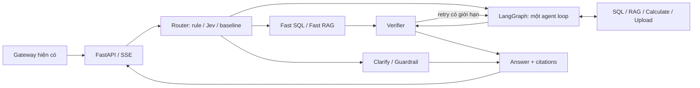

# Ranh giới kiến trúc

Tài liệu này diễn giải sơ đồ do chủ dự án cung cấp. Tất cả thành phần dưới đây
là thiết kế dự kiến, chưa có implementation.

## Online



LangGraph quản lý state, chuyển nhánh, giới hạn số bước và checkpoint. Một agent
loop dùng tools của LangChain; router, verifier và fast path là các node, không
phải những agent độc lập. Khi triển khai phải xử lý timeout, hủy khi client ngắt
kết nối và giới hạn retry. Guardrail về dự đoán/khuyến nghị mua bán theo sơ đồ.

SQL tools dùng tài khoản chỉ đọc và truy vấn tham số cố định cho resolve_security,
get_quote, screen_market, get_price_history, get_financials, get_valuation,
get_corporate_actions. Không đưa quyền chạy SQL tùy ý cho model.

RAG trả chunks + score + citation có asset_uid, trang/block, symbol, kỳ, loại
tài liệu, ngày công bố và URL gốc. Verifier kiểm tra số với tool result và phép
tính xác định; kiểm chứng claim bằng Jev Noul là tùy chọn có baseline so sánh.

## Offline

Dagster kích hoạt pipeline sau khi nguồn assets/news được cập nhật:

```text
MySQL assets/news + OCI
  -> chuẩn hóa metadata và phân loại (Jev hoặc baseline)
  -> PDF render + parser/VLM -> document_pages (text + table_json)
  -> structural parent-child chunks -> Voyage AI embeddings -> Postgres index
                           
Vision table JSON -> metric mapping -> MySQL provider=finsights_vision
                  -> đối chiếu provider A -> vision benchmark
```

Tin tức có thể đi thẳng vào chunking sau chuẩn hóa, không bắt buộc qua PDF/VLM.
Lưu asset_uid và provenance xuyên suốt để có thể ingest lại và truy vết citation.

## Dữ liệu và tích hợp

| Nơi lưu | Vai trò dự kiến |
| --- | --- |
| OCI | PDF, HTML, ảnh gốc |
| MySQL Node 1: finsights_assets / market / news | Nguồn nghiệp vụ hiện có; online chỉ đọc |
| MySQL market: provider=finsights_vision | Đầu ra vision; worker dùng quyền ghi riêng |
| MySQL Node 2: finsights_scraping | Audit crawler hiện có, không tạo lại ở service AI |
| MySQL Node 2: finsights_ai | Chat sessions/messages, tool calls, citations |
| Postgres: finsights_rag | Document pages, chunks, metadata, vectors và lexical index |
| LangGraph checkpoint store | State thực thi; chọn backend khi triển khai, không đồng nhất với chat history |

Postgres full-text mặc định không phải BM25. Khi triển khai phải chọn extension
BM25 phù hợp hoặc dùng baseline full-text khác và ghi rõ cấu hình benchmark.
Không gọi mọi lexical search là BM25. Chốt embedding model/số chiều trước migration.

Jev là API bên ngoài theo sơ đồ, không giả định có sẵn package LangChain hay SDK.
Giữ contract choice/score/Noul trong adapter để thay bằng rule, LLM hoặc classifier.

## Eval và finetune

Eval set khoảng 400 câu theo sơ đồ, dev/test tách biệt; chốt snapshot dữ liệu và
config cho mỗi lần chạy. So sánh LLM no-tool, RAG-only, agent và full pipeline;
ablation router/reranker/classification có và không Jev.

Đo accuracy theo loại câu, unsupported-number rate, recall@5, nDCG@10,
citation accuracy, route accuracy, tỷ lệ câu khó vào fast path, calibration,
vision match rate, cost và latency. Đây là mục tiêu, chưa có benchmark thực tế.

Finetune dùng weak labels trang PDF ↔ provider A, split theo công ty trước khi
tạo mẫu để tránh leakage. Giữ test riêng; weights và dữ liệu lớn ở storage ngoài Git.
